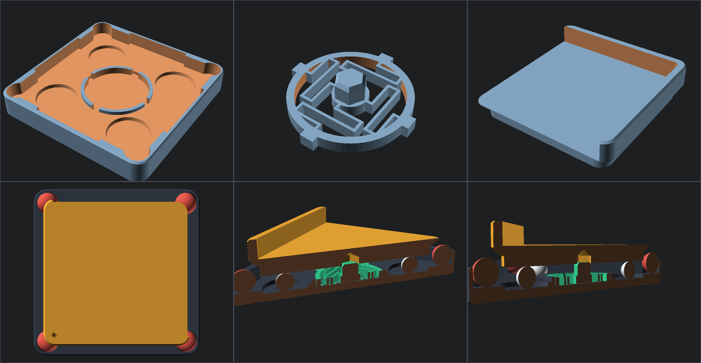

# 樺木板 × 角鋼架專用：V3.0 超軟純平滾珠全向減震座 (Birch Board Ultra-Soft Roller Isolator)

專為 **$42 	imes 42 	imes 1.2	ext{ cm}$ 樺木底板** 與 **免螺絲角鋼架頂層平台（四邊預留 $1.5	ext{ cm}$ 間隙）** 量身設計的「垂直承重與水平回中 100% 解耦」超低剛度滾珠隔震系統。

---

## 核心設計亮點（解決傳統避震墊「過硬失效」問題）

1. **100% 純水平零層紋鋼珠滾道（啟動阻力 $< 30	ext{ g}$）**
   - **垂直承重**：每個角落由 **4 顆 $arnothing 8.0	ext{ mm}$ 鋼珠** 獨立承載於 $arnothing 19.0	ext{ mm}$ 純水平圓形滾道池內，鋼珠之間永不互相摩擦。
   - **鏡面接觸**：`board_isolator_top.stl` 的滾動接觸面直接設計在 $Z=0$ 熱床底面，利用 PEI 打印板的平滑表面與鋼珠對滾，徹底消除 FDM 斜坡層紋階梯造成的卡頓感。
2. **可抽換式 $0.75	ext{ mm}$ 超軟 S 型折疊回中簧片（總水平剛度僅 $\sim 50	ext{ g/mm}$）**
   - `board_isolator_spring.stl` 完全不承受垂直重量，僅靠 4 根壁厚 $0.75	ext{ mm}$（雙噴嘴線寬）的長懸臂提供極輕柔的自動歸位力。
   - 在 $24	ext{ kg}$ 負載下，用**一根小拇指輕推樺木板即可滑順移動**，將打印頭急停換向的水平反作用力切斷 90% 以上，避免角鋼架搖晃。
3. **$\pm 6.5	ext{ mm}$（總擺幅 $1.3	ext{ cm}$）安全全向行程 + 3mm ACF 複合軟邊界**
   - 上托盤自帶 $3.5	ext{ mm}$ 薄壁 L 型包角護邊，直接兜住 $42 	imes 42 	imes 1.2	ext{ cm}$ 樺木板四角。
   - 底座底部設有 $60 	imes 60	ext{ mm}$ **3mm ACF** 對位框（隔絕高頻馬達聲橋並止滑）；內壁四邊設有 **3mm ACF 緩衝條插槽** 與四角 **$arnothing 10	ext{ mm}$ 矽膠球槽**，提供軟性邊界煞車，絕不硬撞牆。

---

## STL 檔案清單（4 個角落共需打印 4 組，100% 免支撐）

| 檔案名稱 | 尺寸 (mm) | 每角數量 | 整機總數 (4角) | 打印與組裝說明 |
| :--- | :--- | :---: | :---: | :--- |
| [`board_isolator_base.stl`](board_isolator_base.stl) | $78.0 	imes 78.0 	imes 12.0$ | 1 | 4 | 底面朝下直接打印；可開啟「僅最頂層表面熨燙 (Top Surface Ironing)」讓鋼珠滾道更滑順。 |
| [`board_isolator_spring.stl`](board_isolator_spring.stl) | $arnothing 34.2 	imes 8.4$ | 1 | 4 | 超軟回中簧片（壁厚 $0.75	ext{ mm}$），卡入底座中央環槽，六角柱朝上。 |
| [`board_isolator_top.stl`](board_isolator_top.stl) | $64.0 	imes 64.0 	imes 16.0$ | 1 | 4 | 平底朝下直接貼於光滑 PEI 熱床打印，L 型護邊朝上托住樺木板角落。 |
| [`v3_board_isolator.scad`](v3_board_isolator.scad) | 參數化原始碼 | - | - | OpenSCAD 完整參數化原始檔。 |
