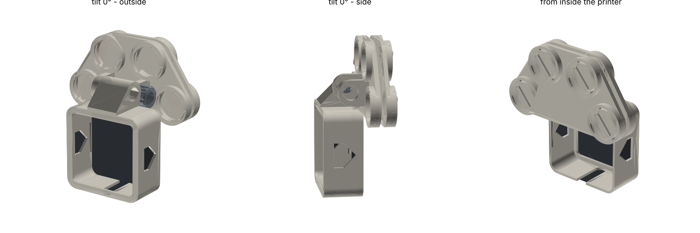
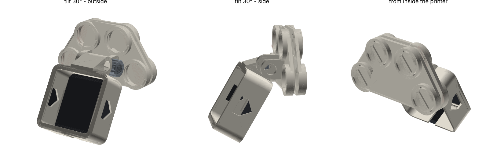

# 3D 列印機艙門磁吸可調角度攝影機支架 (Magnetic Tilt Camera Mount)

把攝影機裝在 3D 列印機（例如 Bambu Lab P1S）的玻璃艙門上：一片底板在門外、一片在門內，靠隔著玻璃互吸的磁鐵固定。這是參考 `12x3inner` / `12x3outer` 原始模型後的**全新設計**，改了三個地方：

1. **磁鐵可以拆下來，Ø6–Ø20 mm、厚 2–5 mm 都能用**：每個磁鐵放進一顆卡扣蓋（Bayonet Cap），蓋子轉 40° 就鎖進底板的通用磁鐵座。不用膠水，也不用壓入。
2. **角度可以調**：攝影機套筒和外底板之間是鉸鏈，0°～90° 都能停，鬆開旋鈕調好再鎖緊就固定。
3. **底板不會擋到畫面**：4 顆磁鐵全部放在攝影機上方。實測在 0°～60° 下俯角之間，HFOV 100°／VFOV 60° 的視野都沒有被擋到。

| 0° (平視) | 30° (下俯) |
| :---: | :---: |
|  |  |

| 調整範圍 0° / 25° / 50° | 爆炸圖 |
| :---: | :---: |
|  |  |

---

## 設計重點

### 1. 通用卡扣磁鐵座（可拆卸、多尺寸）
- **底板上的磁鐵座都一樣**：孔徑 Ø22.75 mm、深 6.5 mm，孔底只留 **0.8 mm** 的薄底朝向玻璃，盡量拉近兩邊磁鐵的距離。
- **尺寸靠換蓋子**：每顆蓋子的外徑都一樣（Ø22.35 + 3 個卡扣耳），差別只在內孔。內孔直徑 = 磁鐵直徑 + 0.35 mm，深度 = 磁鐵厚度 + 0.3 mm，所以磁鐵在蓋子裡不會晃。
- **為什麼磁鐵不用黏死**：磁鐵是被對面的磁鐵隔著玻璃吸過去的，力量會把它壓在 0.8 mm 的薄底上，再透過薄底把整片底板壓向玻璃。蓋子只負責在拆下支架時不讓磁鐵掉出來，所以用卡扣就夠了，不需要過盈配合。
- **鎖法**：卡扣耳對準入口槽壓下去，順時針轉 40° 就鎖住。蓋頂有一條凸起的握把，手指就能轉，也看得出現在是鎖住還是打開。
- **好印**：卡扣槽的頂只是 1.3 mm 的小懸空，磁鐵座開口朝上，底板直接平放列印，不用支撐。

### 2. 上緣鉸鏈：可調角度
- 鉸鏈軸放在攝影機頂邊、靠玻璃那一側（軸心比套筒頂高 10.5 mm、離玻璃 16.3 mm）。往下俯的時候，套筒底部是往外擺離玻璃，所以**整個 0°～90° 範圍內都不會撞到玻璃或底板**（腳本每 2° 檢查一次干涉，結果都是 0）。
- **鎖緊方式**：列印的 **M10×1.5 螺栓**穿過兩片耳板和套筒上的關節，另一頭鎖上 Ø17 的滾花旋鈕。兩片耳板會往內夾住關節，靠摩擦固定，角度可以無段調整。
  - 估算夾持扭矩大約 900 N·mm，攝影機加套筒造成的扭矩大約 40 N·mm，餘裕超過 20 倍。
  - 螺栓頭是六角形，卡在左耳的六角凹槽裡，鎖的時候不用另外拿扳手，單手轉旋鈕就好。
- **只需要往下俯**：如果攝影機裝在門的下半部、要往上看，把整組倒過來裝（磁鐵座左右對稱），再到攝影機 App 裡把畫面翻轉 180° 就行。

### 3. 攝影機套筒
- 內腔 60.4 × 60.4 mm（攝影機本體按 60 × 60 × 26 mm 計算，尺寸是從參考模型量出來的），每邊留 0.2 mm 間隙，內角 R6。
- **鏡頭那一面朝玻璃、整面開口**；背面有 3 mm 的擋唇把攝影機卡住，喇叭孔和背面按鍵都露在外面。
- 底部有一條 9 mm 的開槽，給攝影機的支撐桿和線材通過。兩側開窗方便插拔 SD 卡、通風和操作按鍵。
- 靠玻璃那一端的內側有 0.6 mm 的卡扣凸肋，套筒傾斜時攝影機也不會滑出來。
- 關節下方有一道 **45° 加強斜撐**，背面朝下列印時剛好是自支撐的斜面，**不用支撐**。

---

## 檔案清單

| 檔案 | 數量 | 列印方向 | 說明 |
| :--- | :---: | :--- | :--- |
| [`outer_plate.stl`](outer_plate.stl) | 1 | 貼玻璃的那面朝下 | 門外底板（4 個磁鐵座 + 鉸鏈耳板 + 六角凹槽） |
| [`inner_plate.stl`](inner_plate.stl) | 1 | 貼玻璃的那面朝下 | 門內底板（4 個磁鐵座） |
| [`cradle.stl`](cradle.stl) | 1 | 背面擋唇朝下 | 攝影機套筒 + 鉸鏈關節 |
| [`hinge_bolt.stl`](hinge_bolt.stl) | 1 | 螺栓頭朝下（直立印） | M10×1.5 螺栓，全長 45.5 mm |
| [`hinge_knob.stl`](hinge_knob.stl) | 1 | 平放 | Ø17 滾花旋鈕（內螺紋） |
| [`caps/cap_D{直徑}x{厚度}.stl`](caps/) | 8 | 開口朝下 | 磁鐵卡扣蓋，對應你的磁鐵尺寸 |
| [`caps/cap_D12x3_set_of_8.stl`](caps/cap_D12x3_set_of_8.stl) | 1 盤 | 開口朝下 | Ø12×3 磁鐵用的蓋子 8 顆，排在同一盤 |
| [`scripts/generate.py`](scripts/generate.py) | – | – | 參數化產生器（manifold3d） |
| [`scripts/check_and_render.py`](scripts/check_and_render.py) | – | – | 干涉檢查、視野遮擋檢查、渲染 |

蓋子的尺寸：直徑 **6 / 8 / 10 / 12 / 15 / 18 / 20 mm** × 厚度 **2 / 3 / 4 / 5 mm**，共 28 種。

## BOM

- 圓形釹鐵硼磁鐵 **8 顆**（門內 4、門外 4），Ø6～Ø20、厚 2～5 mm 都可以，**建議 Ø12×3 以上**。
- 不需要任何螺絲或其他五金。

## 組裝步驟

1. 磁鐵放進卡扣蓋，**確認門內和門外對應位置的磁鐵是互相吸引的**（極性相反）。不對的話把磁鐵翻面再放。
2. 卡扣蓋壓進磁鐵座，順時針轉 40° 鎖住。
3. 攝影機鏡頭朝前，從套筒靠玻璃那端推進去，推到背面擋唇卡住為止。支撐桿從底部開槽穿出去。
4. 套筒關節夾進外底板的兩片耳板中間，螺栓從左耳穿過去（六角頭卡進凹槽），右邊鎖上旋鈕。
5. 內底板放在門內，外底板對準位置貼上，兩邊磁鐵會自動對齊吸住。
6. 稍微放鬆旋鈕，調好角度，再鎖緊。

## 列印建議

- **材質**：外側的零件用 PETG 或 PLA 都可以。**門內那片底板和它的卡扣蓋建議用 PETG、ABS 或 ASA**，因為印 ABS 時艙內溫度可能超過 50 °C。
- 層高 0.2 mm（螺栓和旋鈕用 0.12～0.16 mm 會更順），4 圈外牆，填充 30% 以上。
- 螺紋：螺栓外徑縮小 0.1 mm、旋鈕內孔放大 0.15 mm，單邊總間隙 0.25 mm，已確認可以鎖合。如果太緊，把 `generate.py` 裡的 `grow` 參數調大。
- 全部零件**都不用加支撐**。

## 換成你的攝影機尺寸

```bash
pip install manifold3d trimesh numpy
python3 scripts/generate.py --cam-w 60 --cam-h 60 --cam-d 26
python3 scripts/check_and_render.py
```

其他參數（磁鐵最大尺寸、鉸鏈位置、磁鐵座排列、套筒壁厚等）都在 `generate.py` 最上面的 `P` 字典裡。

## 尺寸摘要

- 底板外框 105 × 59 mm，貼玻璃的面完全平整；門外底板含耳板高 25.8 mm，門內底板厚 7.3 mm。
- 套筒外框 64.4 × 64.4 × 28.6 mm，加上關節後高 84.4 mm。
- 0° 時鏡頭到玻璃的距離約 10 mm；30° 時約 32 mm。
