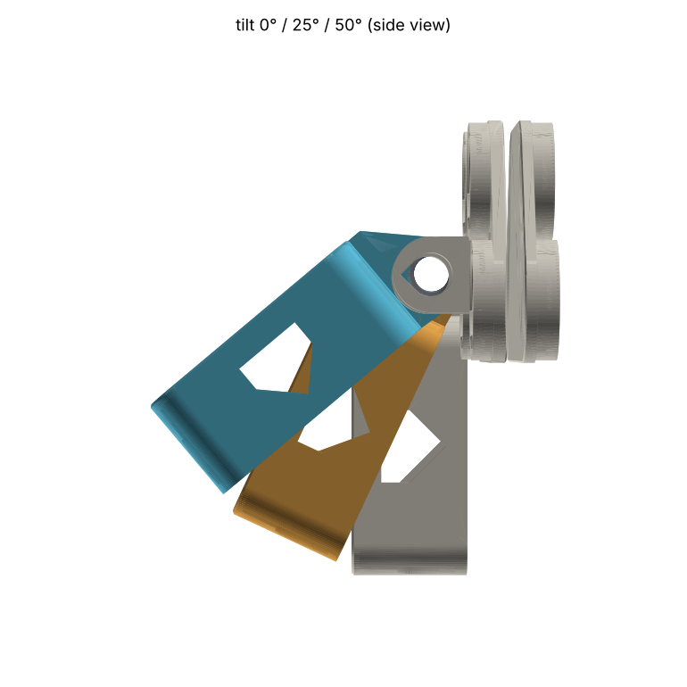
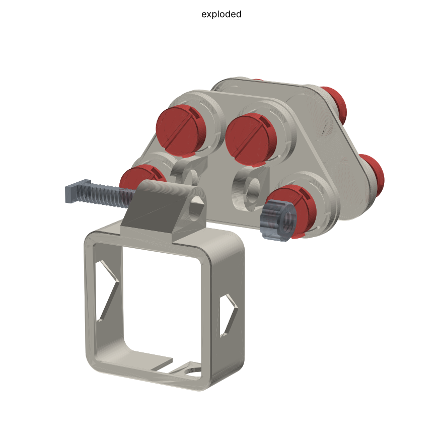
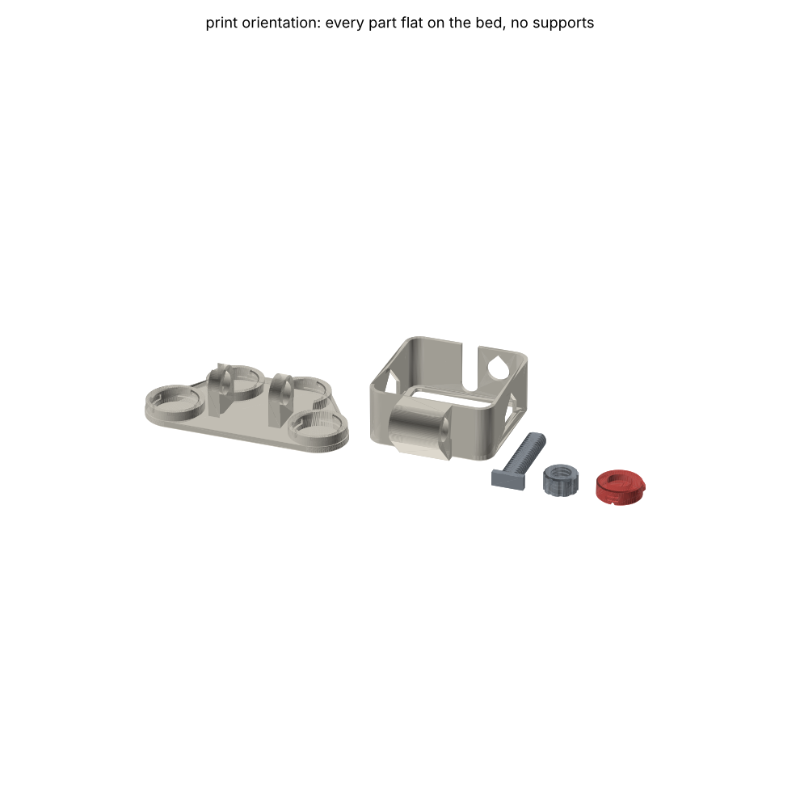
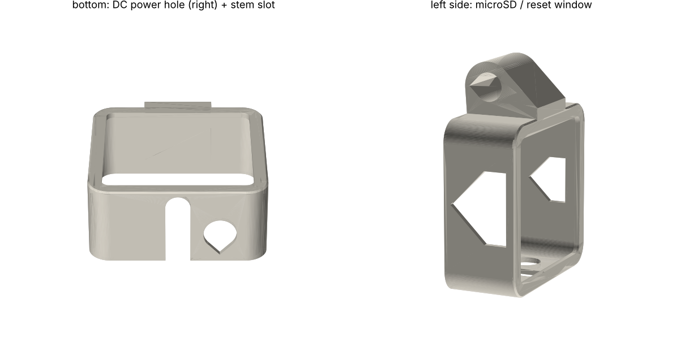
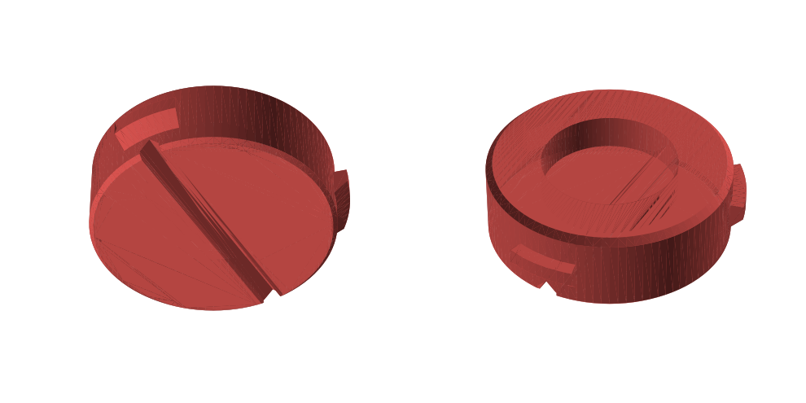
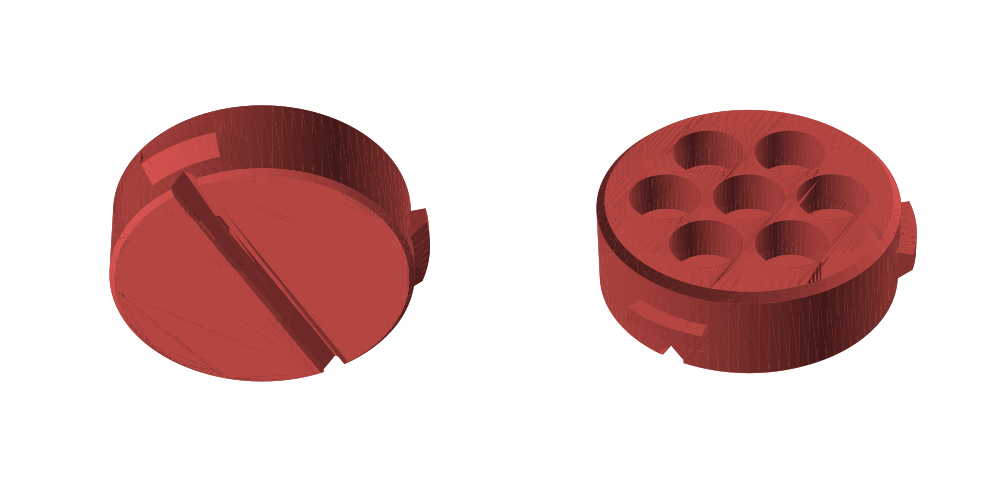

# 3D 列印機艙門磁吸可調角度攝影機支架 (Magnetic Tilt Camera Mount)

專為 **TP-Link Tapo C100 / C110** 設計，裝在 3D 列印機（例如 Bambu Lab P1S）的玻璃艙門上：一片底板在門外、一片在門內，靠隔著玻璃互吸的磁鐵固定。

1. **磁鐵可拆、多尺寸**：磁鐵裝在卡扣蓋裡，蓋子轉 40° 鎖進底板。Ø5～Ø20 × 厚 2～5 mm 都有對應的蓋子，Ø5×3 小磁鐵用 7 顆一組的蓋子。
2. **角度可調**：上緣鉸鏈，0°～90° 無段調整，鬆開旋鈕調好再鎖緊。
3. **不擋畫面**：4 顆磁鐵都在攝影機上方，0°～60° 下俯時底板都不在畫面裡。
4. **好印**：所有零件平放在列印板上，**不用支撐、沒有懸空橋接**，每個配合處都有明確的列印公差（見下方「列印公差」）。

| 0° (平視) | 30° (下俯) |
| :---: | :---: |
|  |  |

| 調整範圍 0° / 25° / 50° | 爆炸圖 |
| :---: | :---: |
|  |  |

---

## 列印方向：全部平放、免支撐



| 檔案 | 數量 | 列印方向（STL 已擺好） | 說明 |
| :--- | :---: | :--- | :--- |
| [`test_fit_coupon.stl`](test_fit_coupon.stl) | 1 | 直接印 | **先印這個**：1 個磁鐵座 + 1 顆 12×3 蓋子，約 10 分鐘，確認卡扣和磁鐵的鬆緊 |
| [`outer_plate.stl`](outer_plate.stl) | 1 | 貼玻璃的面朝下 | 門外底板：4 個磁鐵座 + 鉸鏈耳板 |
| [`inner_plate.stl`](inner_plate.stl) | 1 | 貼玻璃的面朝下 | 門內底板：4 個磁鐵座 |
| [`cradle.stl`](cradle.stl) | 1 | 背面擋唇朝下 | Tapo C100/C110 套筒 + 鉸鏈關節 |
| [`hinge_bolt.stl`](hinge_bolt.stl) | 1 | 平躺，削平的面朝下 | M10 螺栓（螺距 2.0、90° 牙），全長 46.7 mm |
| [`hinge_knob.stl`](hinge_knob.stl) | 1 | 平放 | Ø17 滾花旋鈕 |
| [`caps/cap_D{直徑}x{厚度}.stl`](caps/) | 8 | 投幣槽那面朝下 | 單顆磁鐵卡扣蓋（共 32 種尺寸） |
| [`caps/cap_D5x3_x7_set_of_8.stl`](caps/cap_D5x3_x7_set_of_8.stl) | 1 盤 | 投幣槽那面朝下 | **Ø5×3 用**：7 孔蓋 8 顆一盤（要 56 顆磁鐵） |
| [`caps/cap_D12x3_set_of_8.stl`](caps/cap_D12x3_set_of_8.stl) | 1 盤 | 投幣槽那面朝下 | Ø12×3 用的蓋子 8 顆一盤 |

### 怎麼做到不用支撐、沒有橋接

每個 STL 都用腳本實際檢查過：在它的列印方向下，量出比 45° 更陡的朝下表面和水平懸空面的面積（不算貼在列印板上的那一面）。結果寫在 [`scripts/check_report.txt`](scripts/check_report.txt)。

| 零件 | 超過 46° 的懸垂 | 水平懸空（橋接） | 做法 |
| :--- | :---: | :---: | :--- |
| 外 / 內底板 | 0 | 0 | 卡扣槽的頂改成 **45° 斜頂**；螺栓頭凹槽**上方開口**，完全沒有頂；螺栓孔是水滴形 |
| 套筒 | 0 | 0 | 電源孔、螺栓孔是水滴形；兩側開窗的頂是 **45° 尖頂**；關節下方是 45° 斜撐 |
| 磁鐵蓋（所有尺寸） | 0 | 0 | **改成頂面朝下印**，磁鐵孔朝上開口，不再需要跨過磁鐵孔的橋接；卡扣耳下緣做成 45°；投幣槽是「直壁 + 45° 尖頂」 |
| 旋鈕 | 0 | 0 | 改用 **90° 牙型**（牙面 45°），直立的內螺紋也不會懸空 |
| 螺栓 | 僅 4 mm²，全部在離板 0.5 mm 內 | 0 | 平躺列印，上下削平；只剩削平面邊緣、前兩層高度內約 0.04 mm² 的小碎面 |

---

## 列印公差

所有配合間隙集中在 `scripts/generate.py` 最上面的 `TOL` 表裡，這組數值是給 0.4 mm 噴嘴、0.2 mm 層高、PETG/PLA、切片軟體的 XY 補償設為 0 用的。

| 配合位置 | 間隙（單邊） | 說明 |
| :--- | :---: | :--- |
| 攝影機 ↔ 套筒內腔 | 0.25 | 滑入配合，內腔 60.5 × 60.5 |
| 磁鐵蓋 ↔ 磁鐵座 | 0.25 | 可轉動的滑配 |
| 卡扣耳 ↔ 卡扣槽（徑向 / 上下） | 0.30 / 0.25 | 上下間隙至少一層的厚度 |
| 磁鐵 ↔ 單顆蓋的孔 | 0.20 | 列印的孔通常會小 0.1 mm 左右，留 0.2 讓磁鐵直接放得進去 |
| 磁鐵 ↔ 7 孔蓋的孔 | 0.15 | 輕微緊配，避免同極的磁鐵互相推出來 |
| 套筒關節 ↔ 兩片耳板 | 0.25 | 旋鈕鎖緊時耳板往內彎 0.25 夾住關節 |
| 螺栓 ↔ 耳板 / 關節的孔 | 0.50 | 水滴形孔 |
| 螺紋：螺栓 / 旋鈕 | −0.15 / +0.20 | 單邊總間隙 0.35；平躺印的螺栓會稍微變橢圓，所以螺栓這邊多縮一點 |
| 螺栓頭 ↔ 凹槽 | 0.25 | |
| 貼在列印板上的邊 | 0.4 倒角 | 消除象腳（首層外擴），像底板底緣、蓋子頂緣、旋鈕的螺紋入口 |

**用測試件確認**：先印 `test_fit_coupon.stl`。

- 蓋子要能輕鬆壓進磁鐵座、順時針轉 40° 鎖住，鎖住後拉不出來。
- 太緊就把 `cap_slide` 和 `lug_radial` 各加 0.05；太鬆就各減 0.05。
- 磁鐵放不進去，就把 `mag` 加 0.05。
- 改完後重新跑 `python3 scripts/generate.py`。

腳本會模擬每個配合，結果在 `scripts/check_report.txt`：
- 蓋子在 0°→40° 之間都能轉，反方向轉會被擋住；
- 鎖住時往外拉 1 mm 會被擋住，沒鎖時可以直接拿出來；
- 螺栓可以鎖進旋鈕；
- 螺栓頭轉 5° 就會頂到凹槽，所以不會跟著旋鈕空轉；
- 關節和耳板的間隙是 0.25 mm。

---

## 設計重點

### 1. 卡扣磁鐵座
- 底板上的磁鐵座都一樣：孔徑 Ø22.9、深 7.6 mm，孔底只留 **0.8 mm** 薄底朝向玻璃。
- 磁鐵被對面的磁鐵隔著玻璃吸住，會壓在薄底上，再透過薄底把整片底板壓向玻璃。蓋子只負責在拆下來時不讓磁鐵掉出來，所以不需要黏死。
- 卡扣耳對準入口槽壓下去，**順時針轉 40°** 就鎖住。蓋頂的投幣槽和卡扣耳在同一條線上，看槽的方向就知道有沒有鎖好。用硬幣或一字起子轉。
- 卡扣槽的頂是 45° 斜面，卡扣耳的上緣也是 45°，兩邊斜面貼合：拉出方向會被斜面擋住，列印時也不會有水平懸空。

### 2. 上緣鉸鏈
- 鉸鏈軸在套筒頂邊上方 10.5 mm、離玻璃 17.9 mm。往下俯時套筒底部往外擺，**0°～90° 都不會撞到玻璃、底板、磁鐵蓋或旋鈕**（腳本每 2° 檢查一次）。
- 列印的 M10 螺栓穿過兩片耳板和關節，另一頭鎖上旋鈕，耳板往內夾住關節，靠摩擦固定。
- 螺紋是 **90° 牙型、螺距 2.0**：牙面 45°，直立印（旋鈕）和平躺印（螺栓）都不會懸空；螺距大，轉一圈前進 2 mm，鎖起來快。
- 螺栓頭是 7.2 × 16 × 3 mm 的長方塊，高度跟螺栓削平後一樣，所以整支能平躺在列印板上。它卡在左耳一個**上方開口**的長方形凹槽裡，不會跟著旋鈕轉。
- 螺栓前端有 1.5 mm 不帶牙的 45° 導角，比較容易對準旋鈕。
- 如果攝影機裝在門的下半部、要往上看，把整組倒過來裝（磁鐵座左右對稱），再到 App 把畫面翻轉 180°。

### 3. 套筒（Tapo C100 / C110）
- 鏡頭那面朝玻璃、整面開口；背面有 3 mm 擋唇卡住攝影機，喇叭孔露在外面。
- **DC 電源孔**（5.5×2.1 圓頭插頭）：在**底部、中心偏右 15.1 mm（從門外看）**，孔心距背面擋唇內側 15.6 mm，Ø12 水滴形。插頭插上後也順便把攝影機卡住，不會前後滑。
- **microSD / 重置窗**：在**左側（從門外看）**，靠擋唇那段全寬 27.5 mm，往玻璃方向收成 45° 尖頂。
- 底部正中央有 9 mm 寬的支撐桿開槽，往玻璃那端是開口的。右側另有一個散熱窗。
- **左右方向是在成品 STL 上驗證的**：檢查腳本會讀入要列印的 `cradle.stl`，轉回安裝時的方向，確認電源孔在右下、SD 窗在左側。



### 4. 磁鐵蓋
- 單顆蓋：直徑 **5 / 6 / 8 / 10 / 12 / 15 / 18 / 20 mm** × 厚度 **2 / 3 / 4 / 5 mm**，共 32 種。
- **7 孔蓋**（`_x7`）：Ø5×2、Ø5×3。單顆 5×3 隔著玻璃的吸力只有 12×3 的約 3%，攝影機會滑下來；7 顆一組（中間 1 顆、外圈 6 顆）的總磁矩跟一顆 12×3 差不多（用偶極模型估算，只比較相對大小）。
  - 同一個蓋子裡的 7 顆，**同一極要朝同一個方向**。
  - 先做一個門內、一個門外的蓋子，隔著玻璃試吸，確認吸得住再做齊 8 個。

| 12×3 蓋子 | 5×3 七孔蓋 |
| :---: | :---: |
|  |  |

---

## BOM

- 圓形釹鐵硼磁鐵：用單顆蓋需要 **8 顆**（門內 4、門外 4），建議 Ø12×3 以上；用 Ø5×3 的話需要 **56 顆**（7 孔蓋 × 8）。
- 不需要任何螺絲或其他五金。

## 組裝步驟

1. 磁鐵放進蓋子，**確認門內和門外對應位置的磁鐵互相吸引**。不對就把磁鐵翻面。
2. 蓋子壓進磁鐵座，用硬幣順時針轉 40° 鎖住。
3. 拔掉 Tapo 的電源線，攝影機鏡頭朝前、從套筒靠玻璃那端推進去，推到背面擋唇為止，支撐桿從底部開槽穿出去。
4. 從底部偏右的電源孔把 DC 插頭插回攝影機。
5. 套筒關節夾進外底板的兩片耳板中間，螺栓從左耳穿過去（頭卡進凹槽），右邊鎖上旋鈕。
6. 內底板放在門內，外底板對準位置貼上，兩邊磁鐵會自動對齊吸住。
7. 稍微放鬆旋鈕，調好角度，再鎖緊。

## 列印設定

- **材質**：外側零件用 PETG 或 PLA。**門內底板和它的蓋子建議用 PETG、ABS 或 ASA**，因為印 ABS 時艙內溫度可能超過 50 °C。
- 層高 0.2 mm，4 圈外牆，填充 30% 以上。螺栓建議用 PETG、5 圈外牆。
- 切片軟體的 **XY 尺寸補償保持 0**（公差已經算在模型裡）。
- 不用加支撐。

## 換成其他攝影機 / 調整公差

```bash
pip install manifold3d trimesh numpy
```

```bash
python3 scripts/generate.py --cam-w 60 --cam-h 60 --cam-d 26
```

```bash
python3 scripts/check_and_render.py
```

- 公差在 `TOL` 表。
- 電源孔位置是 `power_x`、`power_from_lip`、`power_d`；SD 窗是 `sd_y`、`sd_from_lip`。
- 其他尺寸都在 `P` 表。
- 所有零件都是先按照安裝的位置建模，再**只用旋轉**轉成列印方向，不會用鏡像，所以左右不會顛倒。

## 尺寸摘要

- 底板 106.7 × 60.7 mm，貼玻璃的面完全平整；門外底板含耳板高 27.4 mm，門內底板厚 8.4 mm。
- 套筒外框 64.5 × 64.5 mm，含關節高 84.5 mm。
- 0° 時鏡頭距玻璃約 9.5 mm，30° 時約 32 mm。
