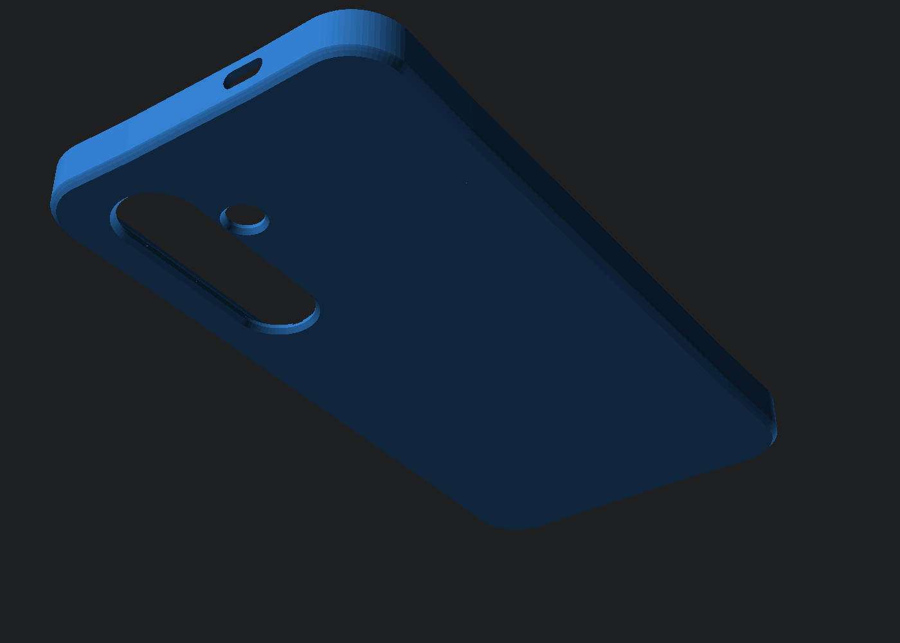

# Samsung Galaxy S24+ (SM-S926) 極簡圓潤人體工學 PETG 全包覆手機殼 (`samsung-s24-plus-petg-case`)

專為 **Samsung Galaxy S24+ / S24 Plus ($158.50 \times 75.90 \times 7.70\text{ mm}$)** 量身打造的 **PETG 半剛性工程塑料專屬全包覆無開槽手機殼（V2.0 極簡純平背板 + 圓潤鵝卵石按鍵升級版）**。針對 PETG「高韌性但低拉伸率（非軟膠 TPU）」的材料力學特性與日常握持手感進行深度優化，實現**四角 100% 封閉無開槽緊配拆裝**、**內藏式彈性細樑 + 圓潤膠囊弧面連體按鍵（完全不割手）**與**純平無紋理外背板**，全件 **100% 免支撐一體成型直印**。

---

## 🛠️ 核心工程與人體工學亮點（V2.0 握感升級版）

1. **全內藏式彈性細樑 + 3D 圓潤膠囊弧面按鍵（徹底消除銳角、完全不割手）**
   - **外側 100% 齊平無凹坑**：徹底取消傳統連體按鍵在外側壁開出的方形減薄凹槽！將 $0.90\text{ mm}$ 彈性細樑的減薄避空槽 **100% 隱藏於手機殼內壁**，使手機殼外側邊框完全連續齊平，手指滑過按鍵兩端時再也摸不到任何銳利台階。
   - **3D 鵝卵石膠囊球頂按鍵帽 (Rounded Pill Dome)**：電源鍵與音量「$+$ / $-$」雙鍵皆採用多階球面平滑隆起的膠囊弧頂造型，搭配電源鍵中央單一光滑微凸球面盲操定位點，手感溫潤飽滿、絕不刮手。
   - **音量鍵中央獨立支點立柱**：在音量上下鍵之間設 $2.2\text{ mm}$ 實心錨點立柱，單段免支撐橋接跨距僅 **$11.1\text{ mm}$**（PETG 直拉過橋 0 垂掛），上下按壓獨立回彈、清脆不連動。

2. **純平極簡外背板 + 多階圓弧過渡邊框 (Multi-Step Fillet)**
   - **100% 純平光滑外背板**：完全移除外背板機甲凹槽與側邊突兀防滑肋，直接呈現 PEI 熱床細膩純淨質感，日常放入口袋順滑不卡、不藏污納垢。
   - **多階擬合圓弧邊框**：外殼上下邊緣採用「$45^\circ$ 起步多階擬合圓角」，兼顧 FDM 首層免支撐列印性與掌心溫潤握感。
   - **齊平式三鏡頭柔順斜切窗**：$1.80\text{ mm}$ 背板厚度恰好保護 S24+ 原廠約 $1.6\text{ mm}$ 鏡頭凸出量；內表面保留 $0.25\text{ mm}$ 淺層菱格散熱微氣槽，輔助均熱板散熱。

3. **全包覆無開槽緊配結構（長邊微薄彈性壁 + 四角漸變微卡扣）**
   - **長邊彈性側壁 ($1.60\text{ mm}$ = 4 圈噴嘴壁厚)** 搭配內壁 $0.28\text{ mm}$ 縱向彈性卸力暗槽，讓左右長邊在拆裝時可微幅外張。
   - **漸變式 $45^\circ$ 前唇卡扣**：四角完全不開縫，但將四角內縮卡扣量漸消至 **$0.22\text{ mm}$**（降低套入阻力），並將 **$0.50\text{ mm}$** 主咬合卡扣配置於具彈性的左右長邊中段，輕鬆卡入、穩固鎖定。

---

## 📸 多視角工程檢視圖

| 正面內腔與漸變卡扣視角 | 背面純平極簡視角 |
| :---: | :---: |
|  |  |
| **右側圓潤膠囊連體按鍵特寫（頂底 100% 全貫穿分離槽）** | **垂直截面剖析（頂底懸空浮動 + 觸發頂針配合）** |
|  |  |
| **水平截面剖析（$0.78\text{ mm}$ 空心微拱形板簧 + $0.05\text{ mm}$ 零預壓間隙）** | **內腔視角（等曲率空心掏空槽 + 圓潤觸發頂針）** |
|  |  |

---

## 📦 檔案清單與規格尺寸

| 檔案名稱 | 外部總尺寸 (mm) | 內部腔體尺寸 (mm) | 說明 |
| :--- | :--- | :--- | :--- |
| [`samsung_s24_plus_case.stl`](samsung_s24_plus_case.stl) | $162.20 \times 79.60 \times 10.50$ | $159.00 \times 76.40 \times 8.05$ | 可直接切片列印之單件水密 STL 模型（背板朝下平貼熱床 $Z=0$）。 |
| [`samsung_s24_plus_case.scad`](samsung_s24_plus_case.scad) | 參數化原始碼 | 公差可自由微調 | OpenSCAD 完整參數化原始碼（支援 `printable` / `assembled` / `cutaway` 模式）。 |

---

## 🖨️ PETG 3D 列印切片建議設定 (Slicing Guidelines)

- **列印方向**：保持 STL 預設方向（**背板朝下平貼熱床 $Z=0$**，螢幕開口朝上 $+Z$）。
- **支撐設定**：**完全關閉支撐 (Supports: None / 100% 免支撐)**。
- **噴嘴與層高**：$0.4\text{ mm}$ 噴嘴，建議層高 **$0.16\text{ mm}$**（或開啟可變層高讓頂底圓角與膠囊按鍵弧面更細膩滑順）。
- **壁厚圈數 (Wall Loops)**：建議設為 **4 圈 (4 Perimeters)**，使 $1.60\text{ mm}$ 長邊側壁與 $0.90\text{ mm}$ 內藏式按鍵彈性樑全部由連續周長線條構成。
- **填充率 (Infill)**：**25% ~ 30% Gyroid（螺旋體）**。
