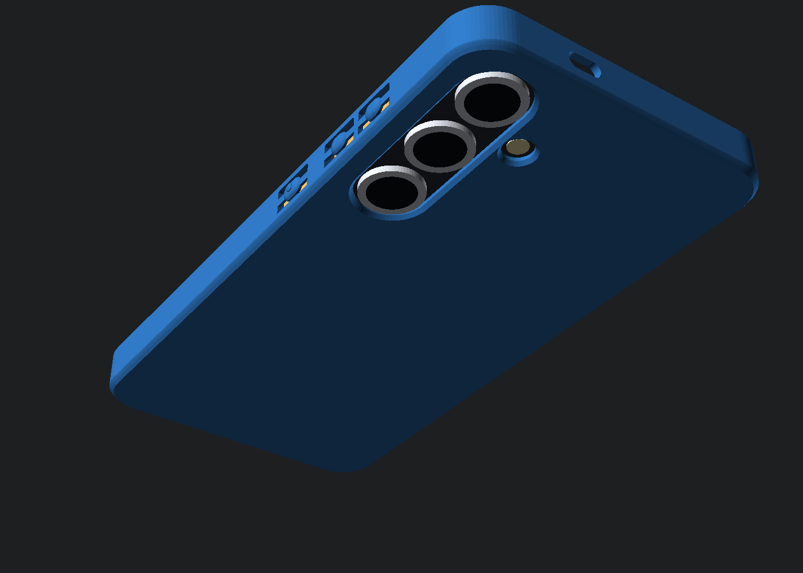
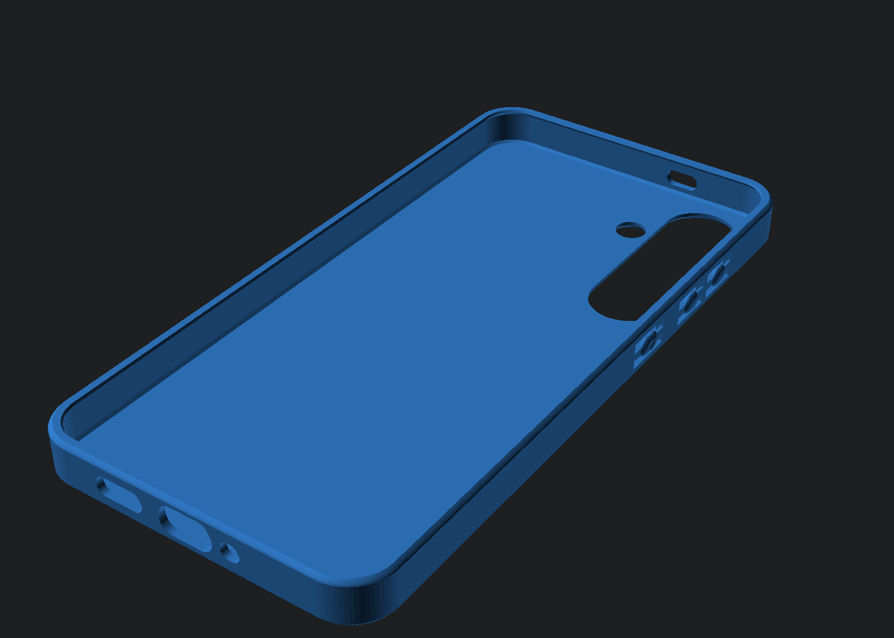
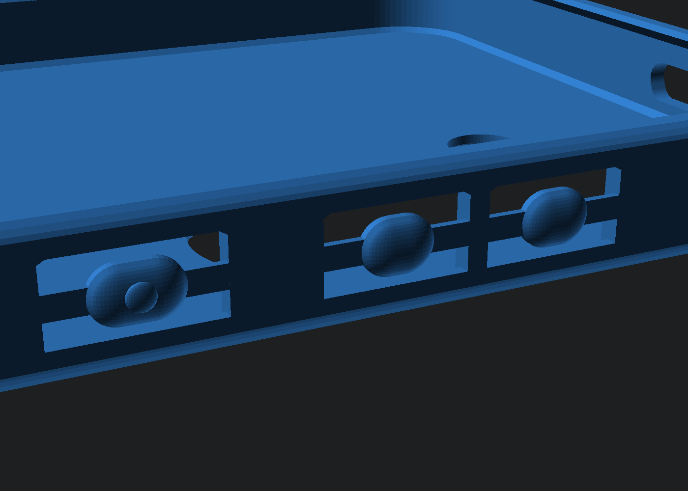
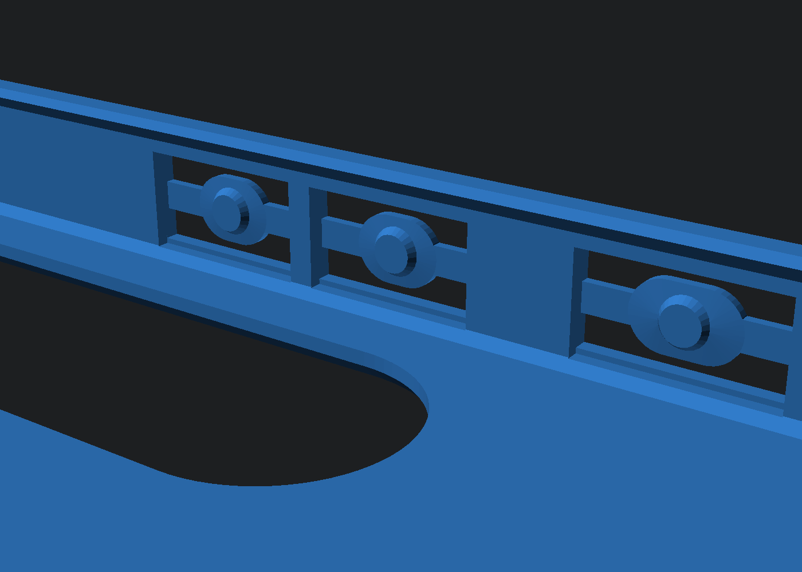
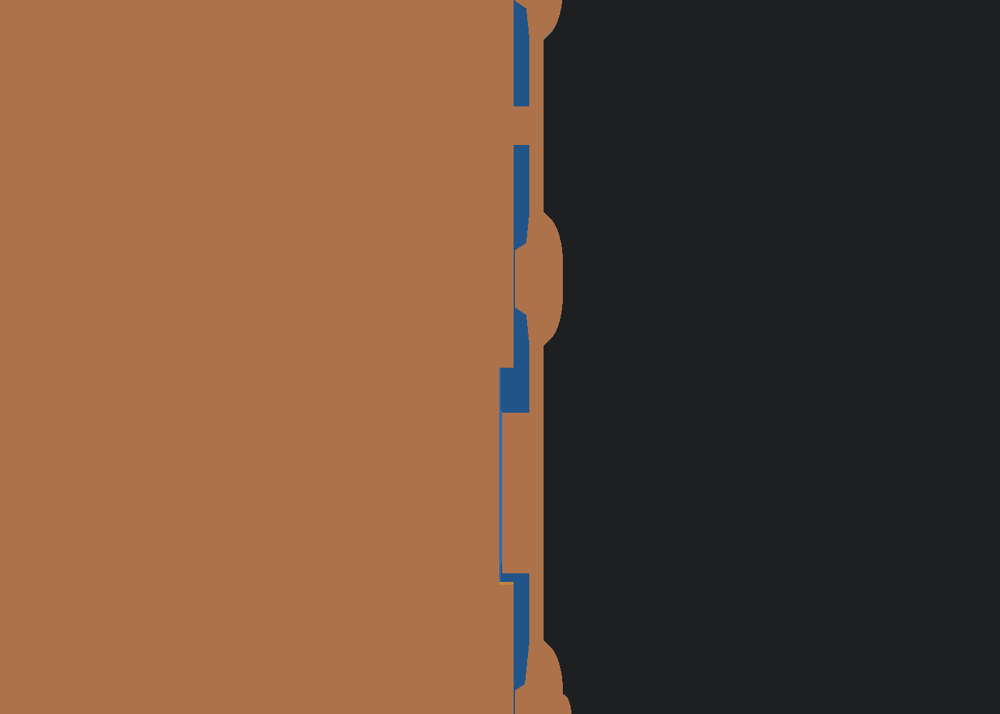
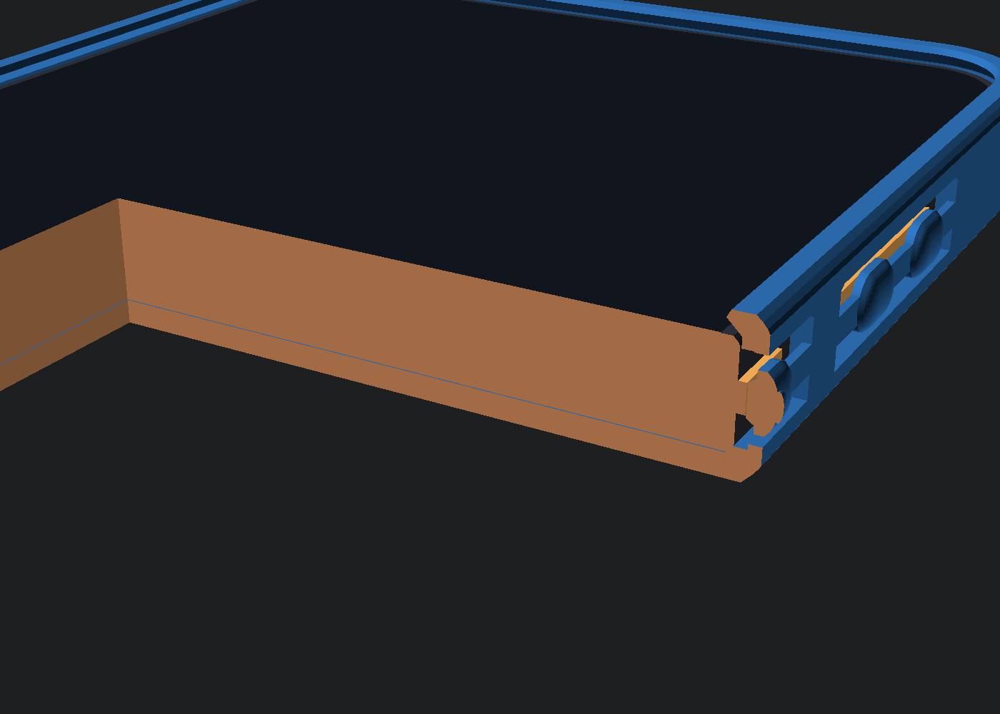

# Samsung Galaxy S24+ (SM-S926) 極簡圓潤人體工學 PETG 全包覆手機殼 (`samsung-s24-plus-petg-case`)

專為 **Samsung Galaxy S24+ / S24 Plus** 量身打造的 **PETG 半剛性工程塑料專屬全包覆無開槽手機殼（V3.0 真機 STEP CAD 逆向對位 + 360° 強效防脫卡扣 + 窄腰薄片超軟連體按鍵版）**。

---

## 🛠️ V3.0 實機測試回饋四大升級重點

1. **100% 實心純平內壁與底板（移除內壁兩側卸力凹槽與內底紋理）**
   - 原本內壁兩側的縱向凹槽是為了輔助側壁外張而設的「彈性卸力槽」，但實測發現會削弱側壁夾持力。V3.0 已將內壁與內底改為 **100% 實心純平結構**，大幅強化側壁包覆剛性。

2. **依據 S24+ 原廠級 STEP CAD (`gs24_plus.step`) 100% 精準校正開孔與按鍵座標**
   - **後置三鏡頭視窗**：中心 $X$ 軸由 $22.45\text{ mm}$ 校正至 **$+25.15\text{ mm}$**（距機身側緣 $12.82\text{ mm}$）；三顆鏡頭中心 $Y$ 軸由舊版偏低約 $3\text{ mm}$ 校正至真機 CAD 座標 **$+66.74\text{ mm}$ / $+49.57\text{ mm}$ / $+32.41\text{ mm}$**（開孔直徑 $16.54\text{ mm}$，完美貼合真機 $\varnothing 14.61\text{ mm}$ 鏡頭環）。
   - **LED 閃光燈孔**：中心由 $(8.50, 55.25)$ 精準校正至 **$X = +11.75\text{ mm}, Y = +58.16\text{ mm}$**（孔徑 $7.10\text{ mm}$）。
   - **機身四角與頂底開孔**：裸機四角半徑校正為 **$R = 8.33\text{ mm}$**；頂部雙麥克風孔校正至 **$X = +13.4\text{ mm}$**（靠近鏡頭側），底部喇叭孔校正至 **$X = -16.2\text{ mm}$**。

3. **解決安裝過鬆問題：收緊內腔公差 + 360° 全周向 $1.10\text{ mm}$ 強效防脫前唇**
   - **收緊內腔尺寸**：內腔寬度由 $76.40\text{ mm}$ 收緊至 **$76.16\text{ mm}$**（半寬 $38.08\text{ mm}$，單邊僅 $0.11\text{ mm}$ 緊配裕度）、內腔長度 **$158.90\text{ mm}$**、垂直深度收緊至 **$7.92\text{ mm}$**。
   - **360° 全周向深咬合防脫卡扣**：將正面防脫卡扣內縮量由舊版 $0.22\sim 0.50\text{ mm}$ 大幅提升至 **左右長邊內縮 $1.10\text{ mm}$**（卡扣內緣達 $X = \pm 36.98\text{ mm}$，實質覆蓋裸機邊框達 **$0.99\text{ mm}$**）、**上下短邊與四角內縮 $0.95\text{ mm}$**，手機推入後四邊與四角皆被牢牢鎖定，絕不掉出！

4. **解決側按鈕過硬問題：全新「$0.60\text{ mm}$ 窄腰純平薄片長懸臂 + 獨立圓潤鵝卵石按鍵島」**
   - **力學解耦設計**：每顆按鍵中央為獨立緊湊的**圓潤鵝卵石按鍵島**（高 $4.30\text{ mm}$），左右兩端改由**高僅 $1.85\text{ mm}$（窄腰）、壁厚僅 $0.60\text{ mm}$、長 $2.80\text{ mm}$ 的純平薄片彈簧臂**懸掛於 $6.40\text{ mm}$ 高的大鏤空窗中央。
   - **抗彎剛度降低 >80 倍**：消除舊版全高弧形殼體的「波浪槽鋼硬化效應」，且彈簧臂上下各留 **$2.27\text{ mm}$ 超大鏤空防沾黏間隙**（按鍵島上下亦保持 $1.05\text{ mm}$ 淨空），音量上下鍵之間設 $1.60\text{ mm}$ 實心錨點立柱隔離，單指輕按即清脆回彈！

---

## 📸 V3.0 多視角工程檢視圖

| 正面內腔與 360° 強效防脫卡扣視角 | 背面純平極簡與校正後鏡頭孔視角 |
| :---: | :---: |
|  |  |
| **右側窄腰薄片長懸臂 + 獨立鵝卵石按鍵島特寫** | **內腔視角（三顆獨立按鍵島 + 實心隔離立柱 + 頂針）** |
|  |  |
| **水平截面剖析（$0.60\text{ mm}$ 純平薄片懸臂 + 頂針貼合）** | **垂直截面剖析（$1.10\text{ mm}$ 強效防脫前唇 + 按鍵懸空）** |
|  |  |

---

## 📦 檔案清單與規格尺寸

| 檔案名稱 | 外部總尺寸 (mm) | 內部腔體尺寸 (mm) | 說明 |
| :--- | :--- | :--- | :--- |
| [`samsung_s24_plus_case.stl`](samsung_s24_plus_case.stl) | $162.40 \times 79.66 \times 11.32$ | $158.90 \times 76.16 \times 7.92$ | 可直接切片列印之 V3.0 單件水密 STL 模型（背板朝下平貼熱床 $Z=0$）。 |
| [`samsung_s24_plus_case.scad`](samsung_s24_plus_case.scad) | 參數化原始碼 | 公差可自由微調 | OpenSCAD 完整參數化原始碼（支援 `printable` / `assembled` / `cutaway_xz` / `cutaway_xy` 模式）。 |
