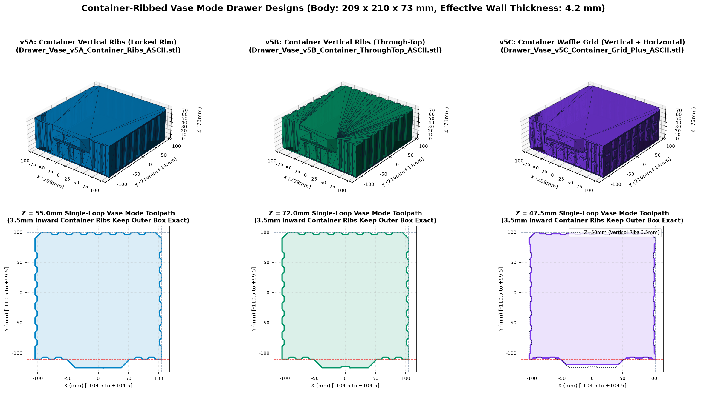
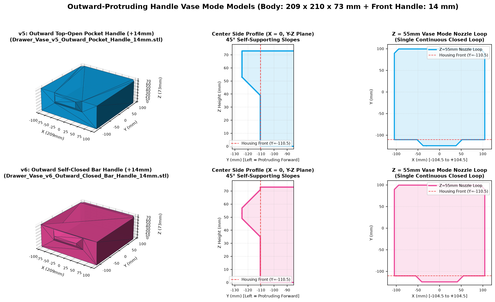

# 花瓶模式高剛性貨櫃紋收納抽屜 (Vase Mode Container-Stiffened Drawer)

專為既有抽屜外盒設計的 **螺旋花瓶模式（Spiral Vase Mode / Spiralize Outer Contour）** 替換抽屜模型。在完全維持原本外部入盒尺寸（`209.0 × 210.0 × 73.0 mm`）的前提下，將原本已抽殼的空心抽屜重構為「花瓶模式專用實心體」，並加入**正前方外凸 14mm 免支撐扣手槽**與**向內凹入 3.5mm 的海運貨櫃箱式梯形加強柱**，徹底解決大跨度（210mm）單層花瓶列印在高度超過 1/3 後容易發生的牆面中心內凹與波浪紋問題。

---

## 📐 核心尺寸與結構規格

| 項目 | 規格數值 | 說明 |
| :--- | :--- | :--- |
| **入盒本體外寬 (X)** | `209.0 mm` (`-104.5 ~ +104.5 mm`) | 與原模型 100% 相同，確保精準滑入既有抽屜外盒 |
| **入盒本體外深 (Y)** | `210.0 mm` (`-110.5 ~ +99.5 mm`) | 保留後方左右兩角 `10 × 10 mm` 的 45° 導引倒角 |
| **抽屜外高 (Z)** | `73.0 mm` (`0.0 ~ 73.0 mm`) | 已歸零貼齊熱床 |
| **正前方外凸把手** | 外凸 `+14.0 mm` (`Y = -124.5 mm`) | 位於正前方不影響入盒，底部為 45° 免支撐斜面，上方與下方雙向皆可扣拉 |
| **貨櫃加強肋深度** | 向內凹入 `3.5 mm`（45° 梯形截面） | 搭配 `0.7 mm` 線寬時，等效抗彎截面厚度達 **`4.2 mm`**（抗彎剛性提升約 25 倍） |

---

## 📦 STL 模型版本總覽（全系列皆為高相容 ASCII STL 格式）

### 1. 主推：貨櫃加強柱 + 正前方外凸把手系列（解決大跨度薄牆內凹與波浪紋）
- **[Drawer_Vase_v5A_Container_Ribs_ASCII.stl](Drawer_Vase_v5A_Container_Ribs_ASCII.stl)** *(首選推薦)*
  - **結構特點**：左、右、後牆各設 7 道、前牆設 8 道向內深 `3.5 mm` 的 45° 貨櫃梯形垂直立柱，底部（`Z = 0~3 mm`）與最頂部框口（`Z = 70~73 mm`）以 45° 斜面收回完整平直外框，把每根垂直柱上下兩端鎖死，消除水平手風琴效應。
- **[Drawer_Vase_v5B_Container_ThroughTop_ASCII.stl](Drawer_Vase_v5B_Container_ThroughTop_ASCII.stl)**
  - **結構特點**：與 `v5A` 相同的 `3.5 mm` 深貨櫃垂直立柱，但立柱一路貫穿至 `Z = 73.0 mm` 最頂端，讓頂部開口邊緣也維持 `4.2 mm` 的凹凸波紋截面厚度。
- **[Drawer_Vase_v5C_Container_Grid_Plus_ASCII.stl](Drawer_Vase_v5C_Container_Grid_Plus_ASCII.stl)** *(終極硬度格柵版)*
  - **結構特點**：在 `3.5 mm` 深的連續垂直貨櫃主柱基礎上，於高度 1/3（`Z = 22~29 mm`）與 2/3（`Z = 44~51 mm`）處交織兩道 `2.0 mm` 深的 45° 水平環狀加強肋，形成正交貨櫃格柵（Waffle Grid）。

---

### 2. 平牆基礎版系列（外凸與內凹把手對比）
- **[Drawer_Vase_v5_Outward_Pocket_Handle_14mm_ASCII.stl](Drawer_Vase_v5_Outward_Pocket_Handle_14mm_ASCII.stl)**：正前方頂部外凸 14mm 開放式扣手槽（平牆基準版）。
- **[Drawer_Vase_v6_Outward_Closed_Bar_Handle_14mm.stl](Drawer_Vase_v6_Outward_Closed_Bar_Handle_14mm.stl)**：正前方中上段外凸 14mm、上下皆以 45° 斜面自封閉的橫條把手。
- **[Drawer_Vase_v1_Pure_Solid.stl](Drawer_Vase_v1_Pure_Solid.stl)**：完全封閉純實心外框柱體。
- **[Drawer_Vase_v2_Shallow_Groove_1.5mm.stl](Drawer_Vase_v2_Shallow_Groove_1.5mm.stl)**：原梯形缺口處向內 1.5mm 淺凹槽定位/裁切版。
- **[Drawer_Vase_v3_Recessed_Handle_12mm.stl](Drawer_Vase_v3_Recessed_Handle_12mm.stl)**：原梯形缺口處向內凹陷 12mm 盲槽拉手版。
- **[Drawer_Vase_v4_DoubleWall_Open_Notch.stl](Drawer_Vase_v4_DoubleWall_Open_Notch.stl)**：保留原 2.0mm 雙層壁厚與開放式梯形缺口之 C 型微縫雙層花瓶版。

---

## ⚙️ 花瓶模式切片建議 (Slicer Settings)

- **特殊模式**：開啟 **螺旋花瓶模式（Spiral Vase / Spiralize Outer Contour）**
- **外牆線寬（Outer Wall Line Width）**：建議設為 **`0.7 ~ 0.8 mm`**
- **層高（Layer Height）**：建議設為 **`0.16 ~ 0.20 mm`**（確保 45° 斜面過渡緊密平滑）
- **底部實心層（Bottom Shell Layers）**：建議 `4 ~ 6 層`（約 `0.8 ~ 1.2 mm`）
- **外牆列印速度**：建議控制在 **`40 ~ 60 mm/s`**，讓厚線寬在貨櫃肋折角處充分冷卻定型
